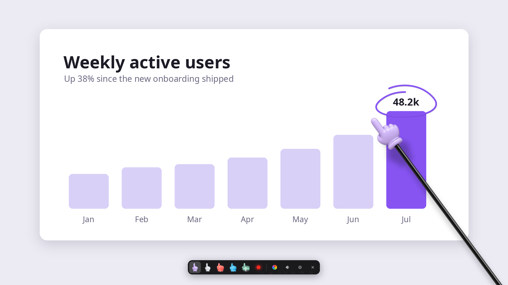
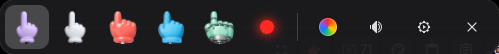
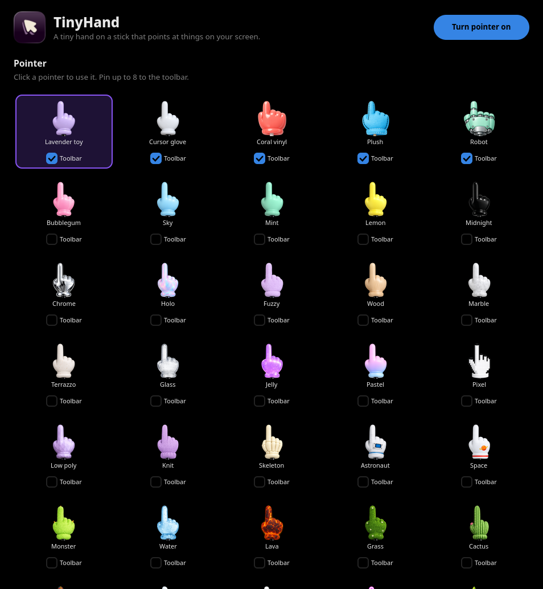

# TinyHand for Linux

A tiny hand on a stick that points at things on your screen. It's handy for screen sharing, demos
and recordings.

This is a Linux (Wayland) port of [TinyHand for macOS](https://github.com/nilbuild/tinyhand) by
Kamran Ahmed, and it uses the original's hand images and tap sounds (MIT).



<sub>The slide is a mock-up. The hand, the ink and the toolbar are drawn by the app itself.</sub>

## Features

- 36 hands and a laser dot. The stick comes up from the bottom of the screen and follows your pointer.
- Click to tap, with a sound and a little press animation. Nothing underneath gets clicked.
- Hold and drag to draw. The ink fades after a few seconds (you can change this or turn it off).
- Hold **Alt** to click for real without turning the pointer off.
- Works across several monitors, including rotated ones and fractional scaling.
- A tray icon with a menu, and a toolbar at the bottom of the screen while the pointer is on.



## Use

| | |
|---|---|
| Click the tray icon, or **Ctrl+Alt+H** | Turn the pointer on or off |
| Right-click the tray icon | Menu and Settings |
| Click | Tap (nothing underneath gets clicked) |
| Hold and drag | Draw on the screen |
| Hold **Alt** | Click for real (change the key in Settings) |
| **Ctrl+Alt+X** | Clear the drawing |
| **Esc** | Clear everything and turn the pointer off |

The toolbar has your pinned hands, the laser dot, ink colour, mute, Settings and exit.

Settings has all the hands, pointer size, shadow, ink fade time, six tap sounds, and which hands
to pin to the toolbar.



### Commands

Commands go to the running app over D-Bus, and start it if it isn't running.

```
tinyhand                start in the background (or open Settings if it's already running)
tinyhand toggle         turn the pointer on or off
tinyhand on | off
tinyhand clear          clear the drawing
tinyhand style NAME     switch pointer, e.g. lavender, robot, pixel, laser
tinyhand settings
tinyhand quit
```

## Install

You need a Wayland compositor with `wlr-layer-shell`, such as niri, Hyprland, Sway or KDE Plasma.
GNOME is not supported.

On Arch:

```
sudo pacman -S --needed python-gobject gtk4 gtk4-layer-shell python-numpy python-pillow gst-plugins-base gst-plugins-good
git clone https://github.com/felri/tinyhand-linux.git
cd tinyhand-linux
./install.sh
```

`install.sh` links `~/.local/bin/tinyhand` and adds an app-menu entry. Then bind the shortcuts
in your compositor.

**niri** (`~/.config/niri/config.kdl`):

```kdl
spawn-at-startup "~/.local/bin/tinyhand"

binds {
    Ctrl+Alt+H hotkey-overlay-title="TinyHand: toggle pointer" { spawn "~/.local/bin/tinyhand" "toggle"; }
    Ctrl+Alt+X hotkey-overlay-title="TinyHand: clear drawing" { spawn "~/.local/bin/tinyhand" "clear"; }
}
```

**Hyprland**:

```
exec-once = ~/.local/bin/tinyhand
bind = CTRL ALT, H, exec, ~/.local/bin/tinyhand toggle
bind = CTRL ALT, X, exec, ~/.local/bin/tinyhand clear
```

**Sway**:

```
exec ~/.local/bin/tinyhand
bindsym Ctrl+Alt+h exec ~/.local/bin/tinyhand toggle
bindsym Ctrl+Alt+x exec ~/.local/bin/tinyhand clear
```

On other distros, install the same libraries: PyGObject, GTK 4, gtk4-layer-shell, NumPy, Pillow
and GStreamer's base and good plugins. Then run `bin/tinyhand` from the repo.

Settings are stored in `~/.config/tinyhand/config.json`.

## How it works

- One transparent full-screen `gtk4-layer-shell` surface per monitor, on the overlay layer. It
  takes the pointer while it's on, so clicks become taps. Holding the interact key empties the
  surface's input region, so clicks go through to the windows below.
- The hand image is split at the wrist. The hand is drawn at its normal size, and the stick is
  stretched so the fingertip lands exactly on the pointer. The grip sits below the bottom edge
  of the screen and eases after the pointer, like the original.
- Drawing uses GSK, so the GPU renders everything.

## Credits and license

MIT. See [LICENSE](LICENSE).

The hand images, tap sounds and the overall design come from
[TinyHand](https://github.com/nilbuild/tinyhand) by Kamran Ahmed (MIT), see
[LICENSE.original](LICENSE.original). This port was written with help from Claude (an AI model).
